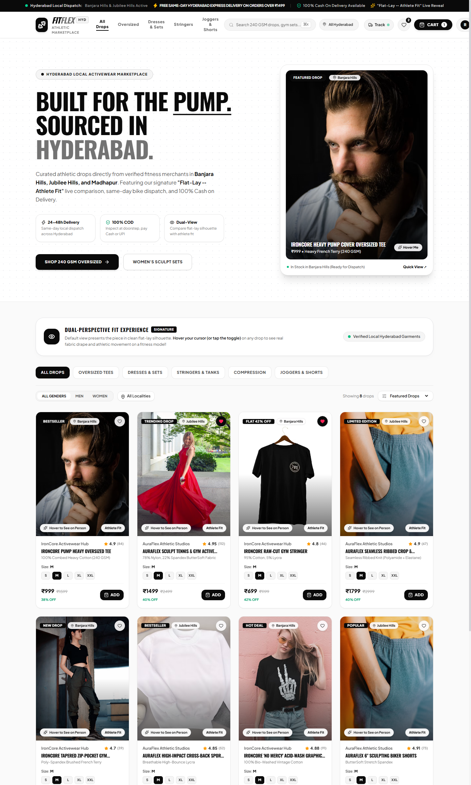

# FitFlex Hyderabad 🏋️‍♂️⚡
> **Local Gym Active Wear Marketplace — "Shop Local. Stay Active."**  
> Inspired by the premium athletic aesthetic of [Fuaark](https://fuaark.com/) with an interactive **"Flat-Lay / Dress to On-Athlete Model Hover Reveal"** visual experience.



---

## 🌟 Key Highlights & Standout Features

1. **Dual-Perspective Apparel Visualization (Requested Feature)**:
   - **Default View**: Standalone gym activewear / dress in crisp studio flat-lay or ghost silhouette.
   - **On Hover (or Tap Toggle)**: Seamlessly cross-fades and reveals how the outfit fits on a muscular athlete / fitness model, showcasing drape, posture, and real gym movement.
   - **Interactive Comparison**: Includes a quick toggle (`[Apparel Only | On Athlete]`) directly on product cards and in the modal view.

2. **Hyper-Local Hyderabad Marketplace**:
   - Curated drops from verified Hyderabad gym & athletic stores:
     - *IronCore Activewear Hub* (Banjara Hills, Road No. 10)
     - *AuraFlex Athletic Studios* (Jubilee Hills, Road No. 36)
     - *GachiFlex Heavy Lifts* (Gachibowli Financial District)
   - Filter by Hyderabad locality: **Madhapur, Banjara Hills, Jubilee Hills, Gachibowli, Kukatpally, Kondapur, Secunderabad**.
   - 24-48 Hour local courier delivery with live status tracking.

3. **100% Cash on Delivery (COD) Checkout & Fleet Tracking**:
   - Zero advance payment required; customers pay upon inspection at doorstep via Cash or UPI.
   - Interactive Delivery Tracker with real-time status steps:
     `Order Placed` ➔ `Seller Confirmed` ➔ `Picked Up by Courier` ➔ `Out for Delivery in Hyderabad` ➔ `Delivered & Cash Collected`.

4. **Multi-Role Experience**:
   - **Buyer Portal**: Fuaark-inspired dark athletic UI, ticker marquee, category filters, quick size selection (`S`, `M`, `L`, `XL`, `XXL`), slide-out Cart Drawer, COD checkout.
   - **Seller Hub**: Manage store profile, publish drops with both flat-lay and on-model URLs, adjust size inventory stocks, track COD order fulfillments, and view net settlement payouts (8.5% platform fee).
   - **Admin Control**: Monitor platform GMV, approve and certify local Hyderabad merchants, and supervise local deliveries.

---

## 🛠️ Technology Stack

| Layer | Technologies |
|---|---|
| **Frontend** | React 18, Vite, Tailwind CSS v4, Lucide React, Axios |
| **Backend** | Java 21, Spring Boot 3.3.4, Spring Security, JWT (JJWT 0.12.5), Spring Data JPA |
| **Databases** | PostgreSQL (Production) + Embedded H2 Database (instant local development) |
| **API Architecture** | RESTful JSON APIs, CORS enabled, Stateless JWT Authorization |

---

## 🚀 Running the Project Locally

### 1. Backend (Spring Boot)
```bash
cd backend
mvn spring-boot:run
```
- Server starts on: `http://localhost:8080`
- API documentation base: `http://localhost:8080/api`
- Preloaded with 8 demo activewear drops, 2 verified Hyderabad stores, and demo user accounts.

#### Switching to PostgreSQL (Optional):
The default profile runs on an embedded in-memory database with zero installation required. To connect to PostgreSQL:
```bash
mvn spring-boot:run -Dspring-boot.run.profiles=postgres
```
Configure your credentials in `src/main/resources/application-postgres.properties`.

---

### 2. Frontend (React + Vite)
```bash
cd frontend
npm install
npm run dev
```
- Dev Server runs at: `http://localhost:5173/`

---

## 🔑 Demo Login Accounts

| Role | Email | Password | Location / Store |
|---|---|---|---|
| **Buyer** | `rahul@fitflex.hyd` | `password123` | Madhapur, Hyderabad |
| **Seller** | `ironcore@fitflex.hyd` | `password123` | IronCore Hub, Banjara Hills |
| **Seller 2** | `auraflex@fitflex.hyd` | `password123` | AuraFlex Studios, Jubilee Hills |
| **Admin** | `admin@fitflex.hyd` | `admin123` | FitFlex HQ, Gachibowli |

*(You can also seamlessly switch roles anytime using the role switcher pills in the top navigation bar!)*

---

## 📐 REST API Endpoints

- `GET /api/products` — Browse products with filters (`category`, `gender`, `locality`, `query`)
- `GET /api/products/{id}` — Single product details with size variants
- `POST /api/auth/register` — Register Buyer or Seller
- `POST /api/auth/login` — Authenticate and receive JWT token
- `GET /api/cart` — Active user cart
- `POST /api/cart/items` — Add item to cart
- `POST /api/orders/checkout` — Place Cash on Delivery order
- `GET /api/orders/my-orders` — Customer order history
- `GET /api/delivery/track/{code}` — Live Hyderabad delivery tracking
- `GET /api/seller/my-store` — Seller store details
- `GET /api/seller/analytics` — Revenue, settlement payout, and order metrics
- `PUT /api/seller/inventory/{variantId}` — Update size stock inventory
